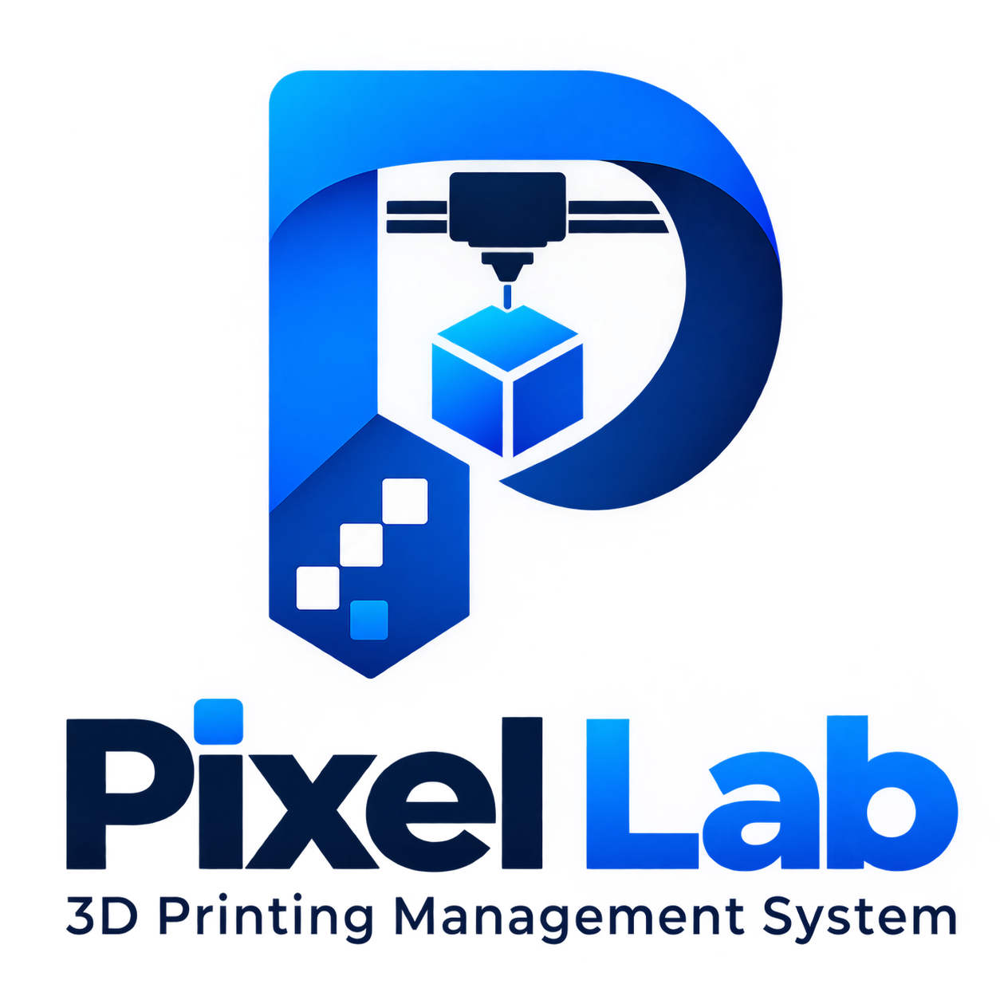
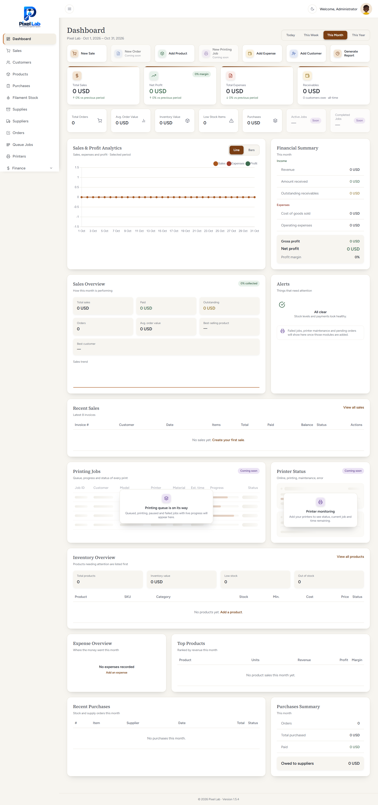
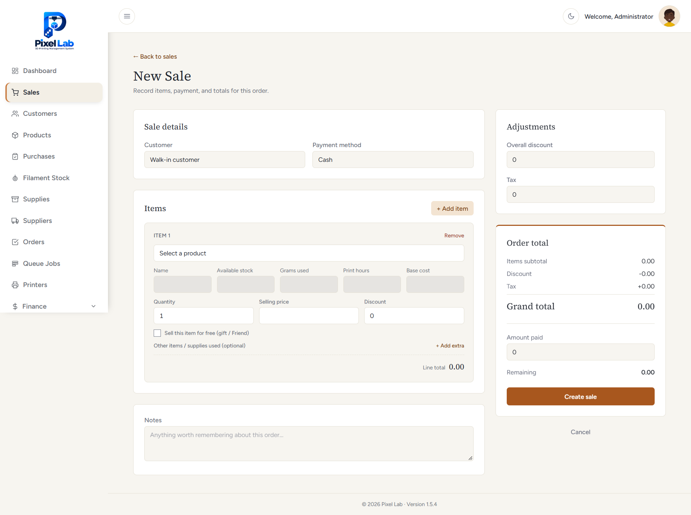
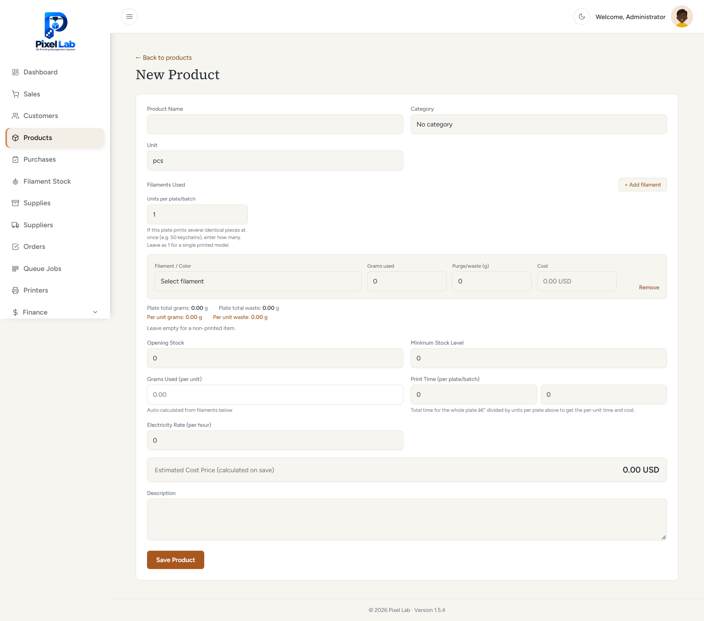
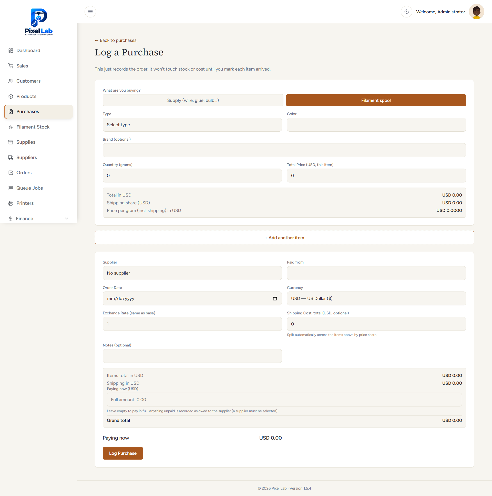

<div align="center">



# Pixel Lab

### 3D Printing Management System

**One centralized web app to manage sales, customers, suppliers, filament & product inventory, expenses and finances for your 3D printing business.**

<br>


[Features](#-features) •
[Screenshots](#-screenshots) •
[Installation](#-installation) •
[Development](#-development) •
[Security](#-security-notes) •
[Support the project](#-support-the-project) •
[Premium](#-premium-package) •
[Support](#-support)

</div>

---

## 📖 About

**Pixel Lab** is a complete business management system built for 3D printing shops. Track every sale, know exactly what you owe and what you're owed, monitor filament cost per gram, and see your real profit, all from a single dashboard.

It runs on a standard PHP server with a local **SQLite** database, so there are **no external services to set up**.

- 🚀 Zero-config database (SQLite)
- 🌗 Light & dark themes
- 📱 Responsive on desktop and mobile
- 🔐 Role-based access control
- 💾 Built-in backup & restore

---

## 🖼 Screenshots

| Dashboard | New Sale |
|:---:|:---:|
|  |  |

| New Product | Log Purchase |
|:---:|:---:|
|  |  |

---

## ✨ Features

### 💰 Sales & Customers
| Module | What it does |
|---|---|
| **Dashboard** | Sales, profit, expenses and receivables at a glance, with period filters (today, week, month, year) and charts |
| **Sales** | Create, track and invoice sales, payments and cancellations, including free items |
| **Customers** | Customer details, history and outstanding balances |

### 📦 Inventory & Purchasing
| Module | What it does |
|---|---|
| **Suppliers** | Supplier records and what you owe them |
| **Purchases** | Purchase orders, arrivals and payments, with multi-currency support |
| **Filament Inventory** | Filament stock, usage and cost per gram |
| **Product Inventory** | Products, stock levels, damaged items and inventory value |
| **Supplies** | Supply management; apply purchases to stock |

### 🏦 Finance
| Module | What it does |
|---|---|
| **Expenses** | Operational expenses by category |
| **Balance & Shareholders** | Account balances, deposits, transfers and shareholder transactions |
| **Transactions** | A clear record of all financial transactions |
| **Employees & Advances** | Employees and their advance payments |

### 📊 Reporting & Administration
| Module | What it does |
|---|---|
| **Reports & Export** | Sales, profit, expense and purchase reports with **PDF, Excel and CSV** export |
| **Users & Roles** | Access control with users, roles and permissions |
| **Audit Logs** | Who did what across the system |
| **Backup & Restore** | Back up your data and restore it when needed |
| **Settings** | Business details, currency, time zone and backup options |

---

## 🧰 Tech Stack

| Layer | Technology |
|---|---|
| Backend | Laravel (PHP 8.3+) |
| Database | SQLite |
| Frontend | Blade, Alpine.js, Tailwind CSS, Vite |
| Access control | [spatie/laravel-permission](https://github.com/spatie/laravel-permission) |

---

## ✅ Requirements

- **PHP 8.3+** with the extensions: `sqlite3`, `pdo_sqlite`, `mbstring`, `xml`, `zip`, `gd`
- [**Composer**](https://getcomposer.org/)
- **Node.js 18+** and npm

---

## 🚀 Installation

> 📘 **Need a detailed walkthrough?** See the full [Setup Guide](SETUP.md) for Windows, Linux, macOS and live-server deployment.

```bash
# 1. Clone the repository
git clone https://github.com/NisarAloko-pixel/Pixel-Lab.git
cd Pixel-Lab

# 2. Install dependencies
composer install
npm install

# 3. Environment file
cp .env.example .env
php artisan key:generate

# 4. Create the SQLite database
touch database/database.sqlite        # Windows PowerShell: New-Item database\database.sqlite

# 5. Set your administrator login in .env (see below), then build the database
php artisan migrate --seed

# 6. Build assets and start the app
npm run build
php artisan serve
```

Open **<http://127.0.0.1:8000>** and sign in with the administrator account you set in `.env`.

### 🔑 Administrator account

Set these values in `.env` **before** running `php artisan migrate --seed`:

```env
ADMIN_EMAIL=admin@example.com
ADMIN_PASSWORD=choose-a-strong-password
```

> [!WARNING]
> Always choose your own strong password. Never use a simple or example password on a live server.

---

## 🛠 Development

```bash
npm run dev          # Vite dev server with hot reload
php artisan serve    # PHP development server
```

**Useful commands**

```bash
php artisan optimize:clear   # clear config, route, view and cache files
php artisan route:list       # list all routes
php artisan migrate:status   # check pending migrations
```

---

## 🗂 Project Structure

```
app/                  Controllers, models, services, exports
database/migrations/  Database schema
database/seeders/     Admin user, categories and default settings
resources/views/      Blade templates
routes/               Web and auth routes
```

---

## 🔒 Security Notes

- Never commit your `.env` file or any `.sqlite` database. Both are listed in `.gitignore`.
- Use `APP_ENV=production` and `APP_DEBUG=false` on a live server.
- Serve the app over **HTTPS** and point the web server at the `public/` directory only.
- Change the default administrator password immediately after the first login.

---

## 💬 Support

Found a problem or something isn't working correctly?

- 📧 **Email:** [nisaraymal@gmail.com](mailto:nisaraymal@gmail.com)
- 💬 **WhatsApp:** [+93 76 4000 785](https://wa.me/93764000785)

Professional deployment, desktop or mobile packaging and multi-computer setups are available on request.

---

## ☕ Support the Project

Pixel Lab is built and maintained with care. If it saves you time or helps your business, a small tip is always appreciated and helps keep the project improving. Thank you! 💙

<div align="center">

<table>
  <tr>
    <th align="center">☕ Ko-fi</th>
    <th align="center">💳 PayPal</th>
  </tr>
  <tr>
    <td align="center">
      <a href="https://ko-fi.com/Z4Q329FKC2" target="_blank">
        
      </a>
    </td>
    <td align="center">
      <br>
      <sub>Scan with your phone to tip via PayPal</sub>
    </td>
  </tr>
</table>

</div>

---

## 💎 Premium Package

**Take your system further.** Need Pixel Lab as a desktop or mobile application, or want to run it across multiple computers with shared data? Professional deployment and custom setups are available.

| 🖥 Desktop Application | 📱 Mobile Application | 🔗 Multi-Computer Setup |
|:---:|:---:|:---:|
| Run the system as a dedicated desktop application. | Access your business system from supported mobile devices. | Run the system across multiple computers with centralized shared data. |

<div align="center">

[](mailto:nisaraymal@gmail.com?subject=Premium%20setup%20inquiry)
[](https://wa.me/93764000785)

</div>

---

<div align="center">

### 👨‍💻 Author

Built by **NiSaR Aloko**: practical, reliable and modern business management solutions.

⭐ If you find this project useful, please consider giving it a star!

</div>
